# Colorful-Wikipedia
A custom skin customizer and web page editor for the website Wikipedia. 

This is a browser extension that currently works on both Chrome and Firefox. This extension allows you to edit all colors of text, page background, content background, links, and many more.

### Installation

As of 11/10/2026 these are both in review for the extension store on Firefox and Chrome. So to download these follow the steps below. 

To use this just simply download the repository and go to your browsers extension settings. In Chrome you will have to turn on developer mode, then click load package. For Firefox go to about:debugging, click on this Firefox on the left hand side, then click load temp extension, and finally click on manifest.json. If the steps were followed correctly the add-on should be loaded. To load the themes you will have to individually click on load theme in the extension pop up. Then load the theme you want. To edit other variables just use the extension pop up or click open in new tab.

### Other libraries used:
 - Coloris: used for the color pickers when editing custom colors.

### Image examples of Themes:
#### Index example:
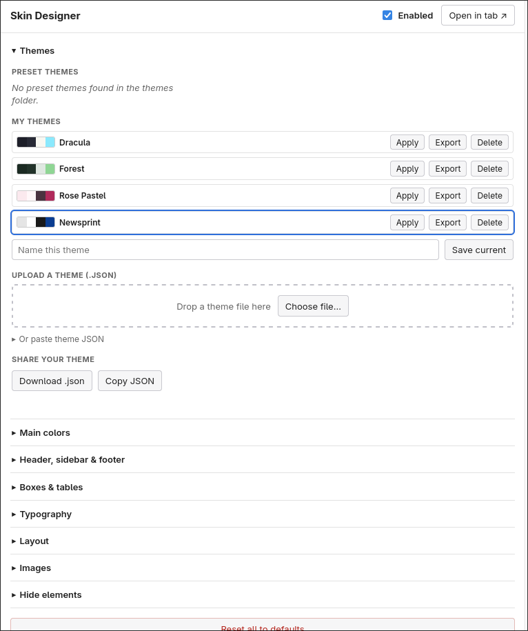\
This is what the editor looks like. (with the loaded themes)

#### Dracula theme example:
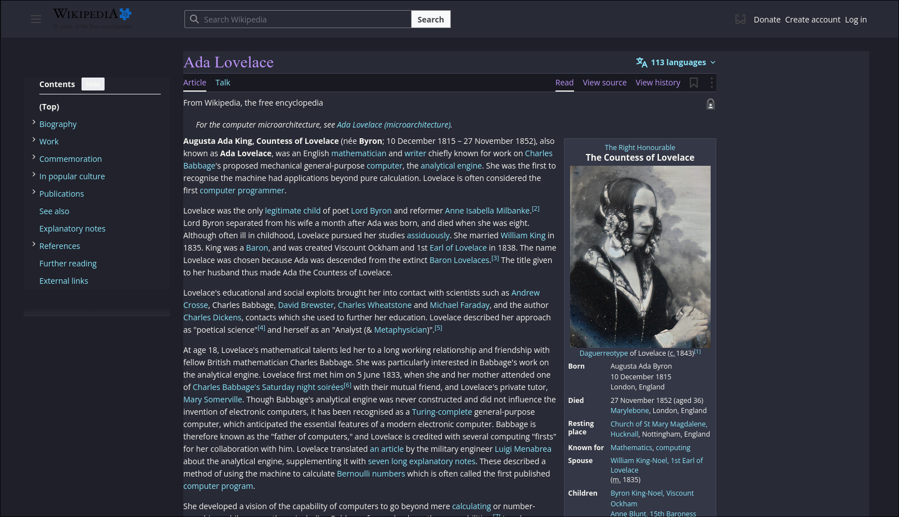\

#### Forest theme example:
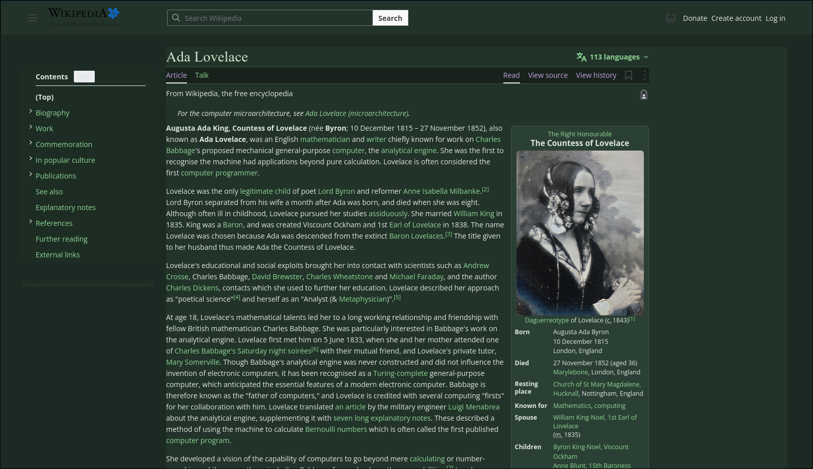

#### High Contrast theme example:
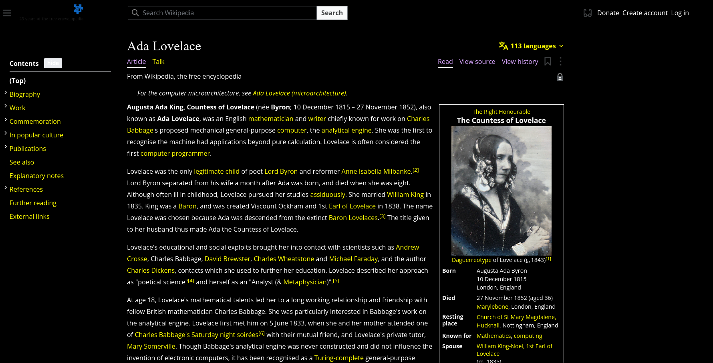

#### Midnight theme example:
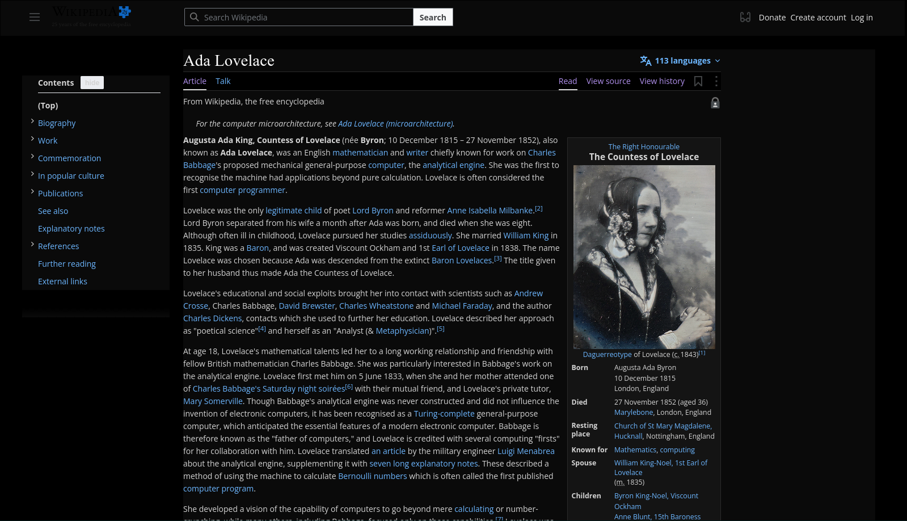

#### Newspaper theme example:
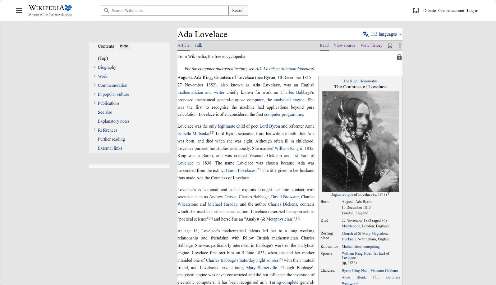

#### Nord theme example:
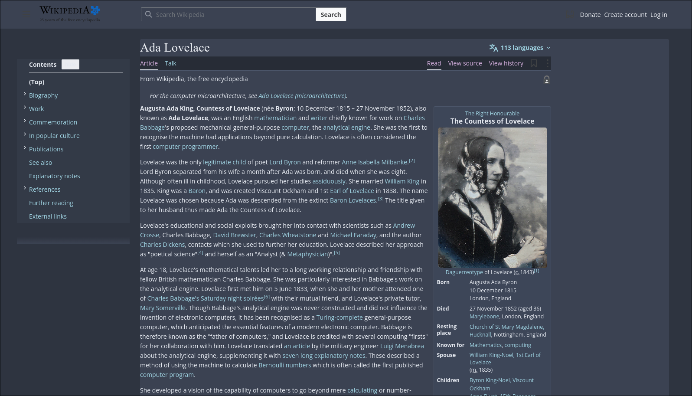

#### Rose theme example:
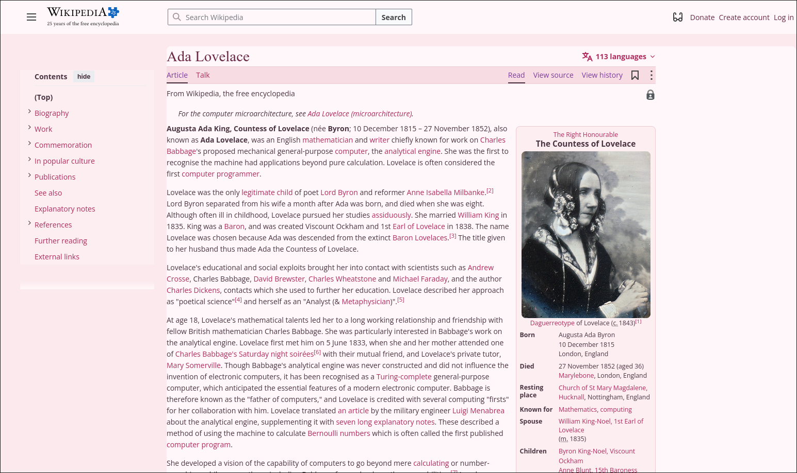

#### Sepia theme example:
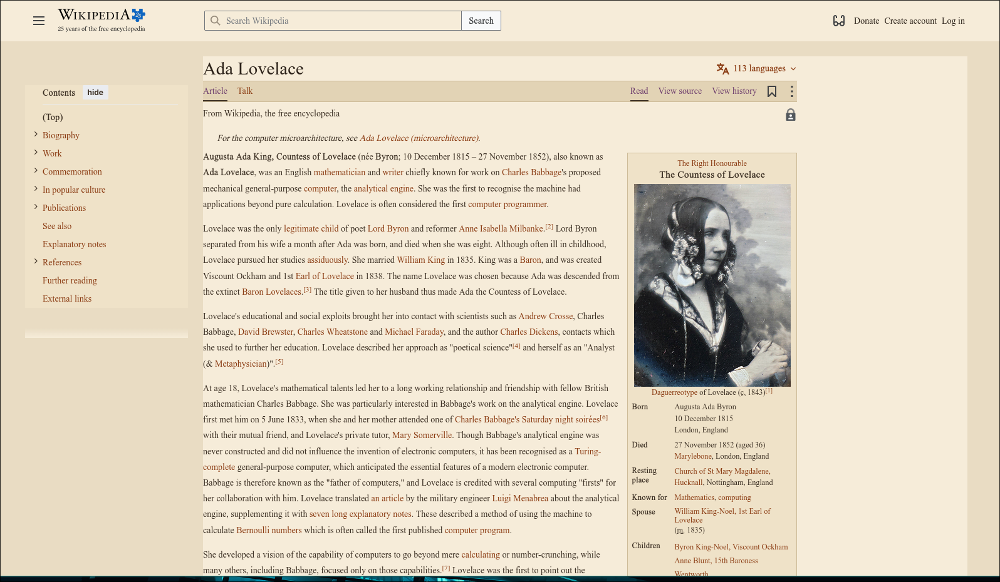

#### Solarized Dark theme example:
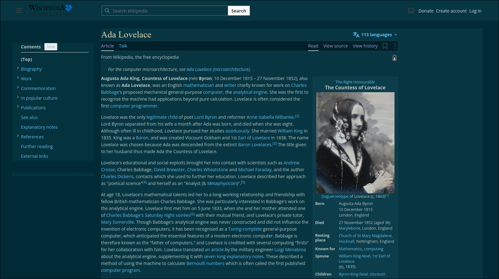

#### Solarized Light theme example:
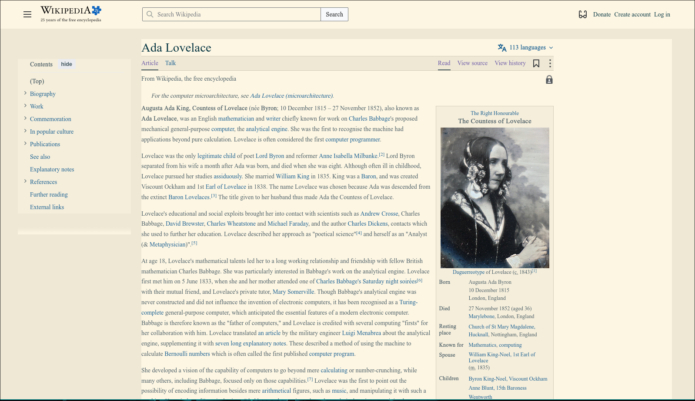
